# OASIS_OS

An embeddable operating system framework in Rust. One codebase renders a full desktop environment -- window manager, browser engine, terminal, 15 apps, 17 skins -- to a 333 MHz PSP handheld, a desktop window, a web page, and an Unreal Engine 5 viewport. Give it a pixel buffer and an input stream and it runs anywhere.

**[Try it in your browser](https://andrewaltimit.github.io/oasis-os/demo/)** -- no install required. | **[Project site](https://andrewaltimit.github.io/oasis-os/)** | **[Developer's Journal](https://andrewaltimit.github.io/oasis-os/journal/)** | **[All 17 skins](SCREENSHOTS.md)**

https://github.com/user-attachments/assets/8e12988e-fb1a-4a4e-a0e5-e1f04d8cd433

| Altimit | Paper | XP | Win95 | Retro CGA |
|:---:|:---:|:---:|:---:|:---:|
| 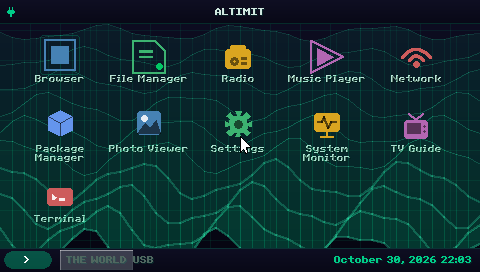 | 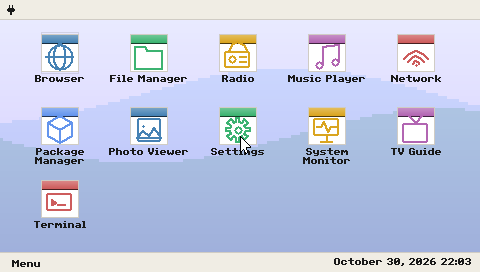 | 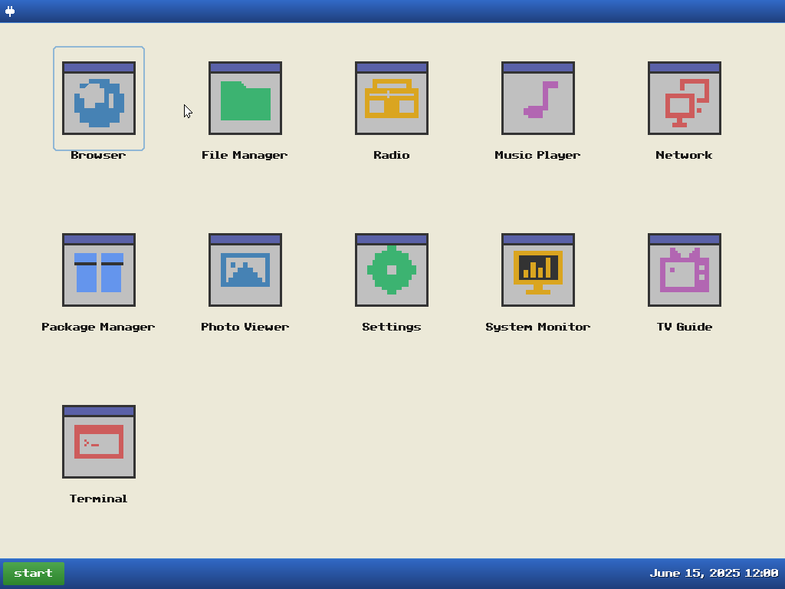 | 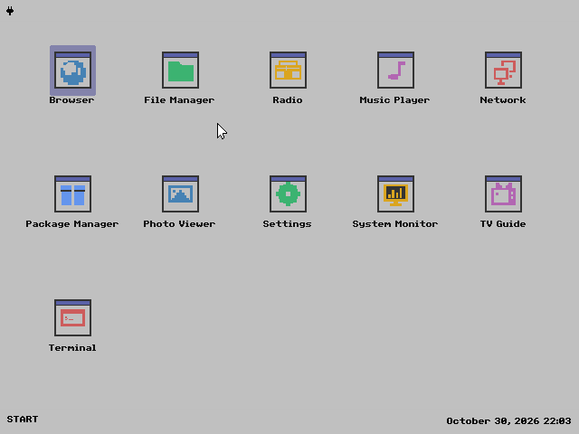 | 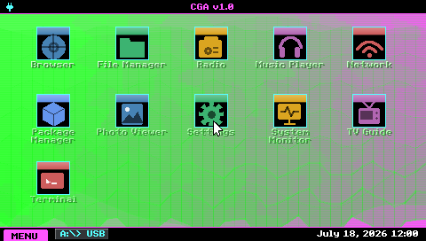 |

| macOS | GNOME | Balatro | Solarized | Vaporwave |
|:---:|:---:|:---:|:---:|:---:|
| 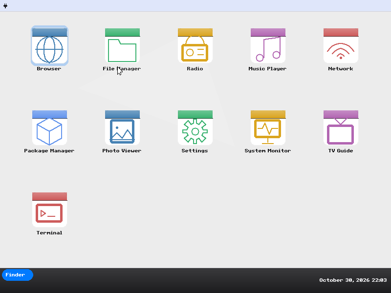 | 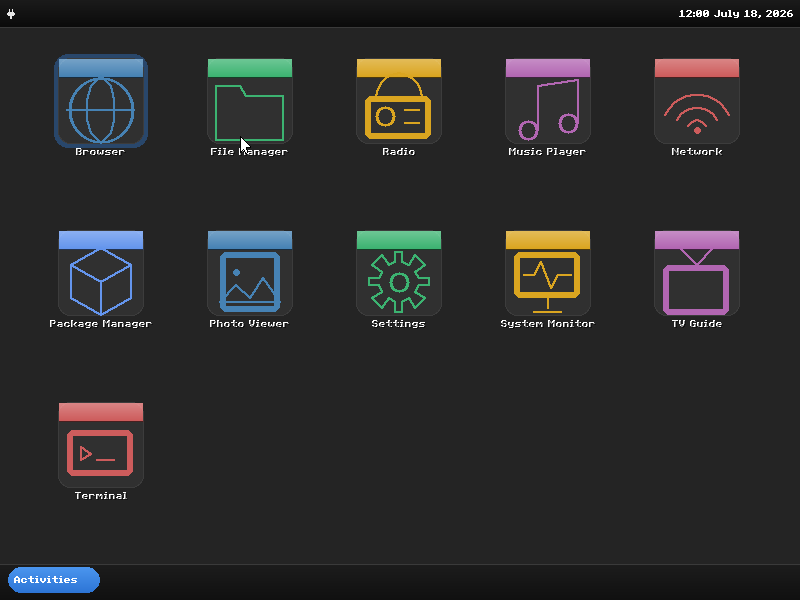 | 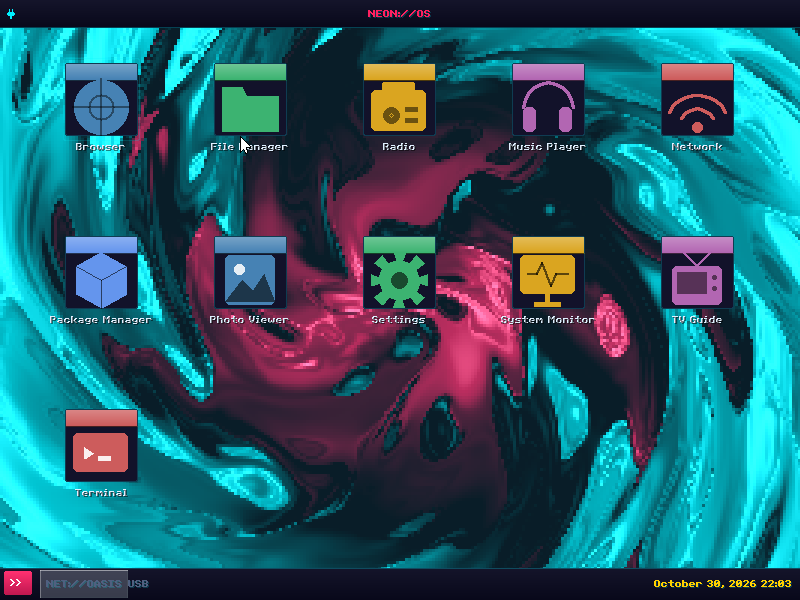 | 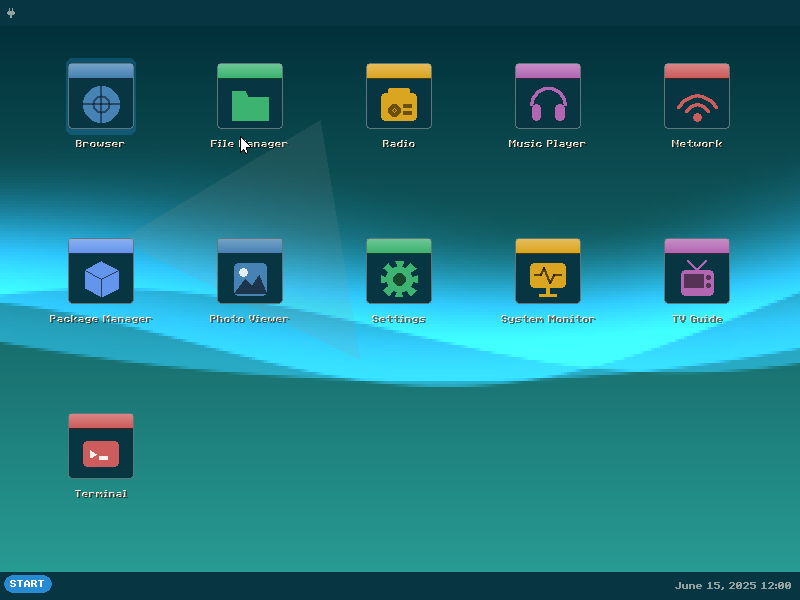 | 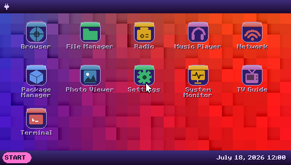 |

## Platforms

| Target | Backend | Build | Guide |
|--------|---------|-------|-------|
| Desktop (Linux, Windows; Raspberry Pi planned) | SDL3 | `cargo build --release -p oasis-app` | [Getting Started](docs/getting-started.md) |
| Web | WASM + Canvas 2D | `./scripts/build-wasm.sh --release` | [WASM Backend](docs/wasm-backend.md) |
| PSP / PPSSPP | sceGu hardware GPU, Media Engine video | `RUST_PSP_BUILD_STD=1 cargo psp --release` in `crates/oasis-backend-psp` | [PSP Architecture](docs/psp-architecture.md) |
| Unreal Engine 5 (or any C host) | Software RGBA framebuffer over a C ABI | `cargo build --profile release-ffi -p oasis-ffi` | [FFI Integration](docs/ffi-integration.md) |

## Quick start

```bash
cargo run --release -p oasis-app            # classic skin
cargo run --release -p oasis-app -- xp      # any built-in skin by name, or a skin directory
```

SDL3 is compiled from source automatically (needs cmake and the X11/audio headers on Linux). The default features link system ffmpeg for video; without the ffmpeg dev libraries (e.g. on Windows) use the openh264 decoder instead:

```bash
cargo run --release -p oasis-app --no-default-features --features javascript,video-decode
```

Per-platform dependencies, feature flags (`skin-dev`, `mcp`), environment variables, the WASM, PSP and UE5 builds, and tests are in [Getting Started](docs/getting-started.md). The Docker image CI uses: `docker compose --profile ci run --rm rust-ci cargo build --release -p oasis-app`.

## What's inside

**Shell and apps**
- 15 apps: File Manager, Browser, TV Guide, Internet Radio, Music Player, Photo Viewer, Paint, Games, Calculator, Text Editor, Terminal, Settings, Network, Package Manager, System Monitor
- Terminal with ~95 commands plus 20 shell builtins: piping, globs, aliases, `$(...)`, `if`/`while`/`for`/`case` scripting, background jobs, readline editing, tab completion, persistent history ([catalogue](docs/terminal-commands.md))
- Window manager with drag/resize, snapping, Alt+Tab, tiling layouts, virtual desktops and animations ([API](docs/window-manager.md))
- TV Guide streams Internet Archive video with hardware H.264 decode on PSP and software decode on desktop; Internet Radio streams curated Archive collections

**Browser engine** ([feature catalogue](docs/browser-engine.md))
- HTML/CSS with the full cascade, flex, table and Grid layout, 2D + 3D transforms, `@media` / `@container` / `@layer` / `@supports`, `var()`, transitions, Canvas 2D, SVG, forms, web fonts, reader mode, Gemini
- JavaScript via QuickJS-NG on every backend including real PSP hardware: a broad DOM API, Promise-based `fetch()`, per-origin storage, and per-tick time and heap budgets so runaway scripts cannot freeze the shell
- HTTP/1.1 + HTTP/2 over rustls with an RFC 6265 cookie jar, enforced CSP and per-hop redirect rules ([security model](docs/security.md))

**Rendering and theming**
- Scene graph (SDI) with z-order, gradients, rounded corners, shadows and exact dirty tracking so idle frames skip redraws
- 29 widgets plus list, menu, nine-patch, icon atlas and flex/grid layout helpers ([catalogue](docs/ui-widgets.md))
- 17 skins, each an editable TOML directory under [`skins/`](skins/) with theme derivation from 9 base colors ([authoring guide](docs/skin-authoring.md))
- 8 animated shader wallpapers, each with a GPU and a CPU implementation ([shaders](docs/shaders.md)); resolution-independent vector icons and animations

**Platform and integration**
- Remote terminal with PSK authentication over TLS (loopback-only unless a PSK is set) ([networking](docs/networking.md))
- Optional MCP control server so a local agent can drive the shell ([MCP server](docs/mcp-server.md))
- Plugins, VFS-based IPC, and a virtual file system with in-memory, jailed host-directory and UE5 game-asset implementations ([plugins](docs/plugin-development.md))

## The PSP story

The PSP is the original muse and the most demanding target: a 2004 handheld with a 333 MHz MIPS CPU, 32 MB of RAM and firmware from 2008. Making a modern streaming video app work on it took:

- **TLS 1.3 in pure Rust** via `embedded-tls` on bare-metal MIPS -- Sony's firmware ships SSL 3.0 and 2008 root CAs. This enables HTTPS to modern servers like archive.org.
- **Hardware H.264 decode** on the Media Engine, a second MIPS CPU with no public homebrew documentation. We [reverse engineered the ME's RPC protocol](https://andrewaltimit.github.io/oasis-os/journal/07-psp-media-engine.html) and drive it from Rust; a kernel PRX watchdog recovers a firmware deadlock for indefinite stable streaming.
- **In-memory streaming**: MP4 over TLS, demuxed on the fly, H.264 NAL units to the ME and AAC frames to `sceAudiocodec`, with no disk I/O during playback.
- **A kernel-mode overlay PRX** that draws UI over any running game and plays background MP3s.
- **Closed-loop remote development**: a [TCP command server](https://andrewaltimit.github.io/oasis-os/journal/08-remote-dev-automation.html) inside the EBOOT for WiFi build-deploy-test cycles, input injection and framebuffer capture, plus a 154 KB network recovery EBOOT (hold R on boot) that makes the device unbrickable. An AI agent used it to debug the whole H.264 pipeline -- 30+ deploy-test iterations in one session without touching the device.

https://github.com/user-attachments/assets/3d84aea5-969c-4f38-af67-c088a7c37764

*Closed-loop demo: an AI agent connects to the PSP over WiFi, launches TV Guide, tunes a channel, windows the app, then power-cycles it through a USB relay-controlled actuator -- zero human contact.*

Interactive 3D blueprints of the custom hardware: the [PSP USB-C adapter](https://andrewaltimit.github.io/oasis-os/blueprint.html?diagram=psp-usb-adapter) (passive bridge: power pads + Mini-B data into one USB-C port) and the [hard reset relay](https://andrewaltimit.github.io/oasis-os/blueprint.html?diagram=psp-relay) (H-bridge wiring for remote reboot).

| PSP USB-C Adapter | PSP Hard Reset Relay |
|:---:|:---:|
| [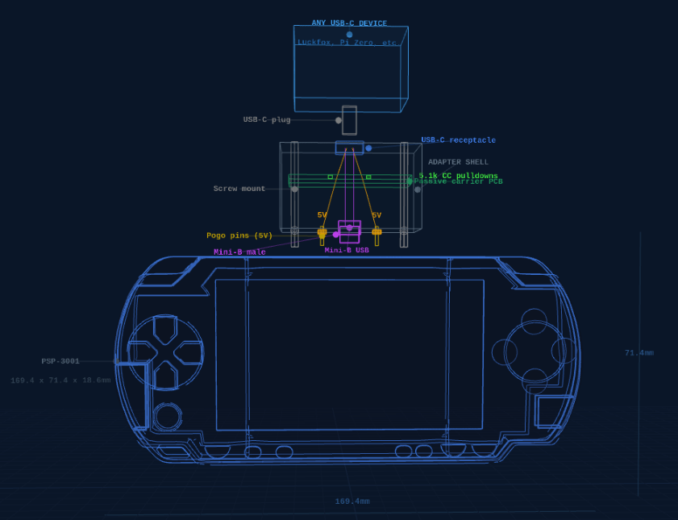](https://andrewaltimit.github.io/oasis-os/blueprint.html?diagram=psp-usb-adapter) | [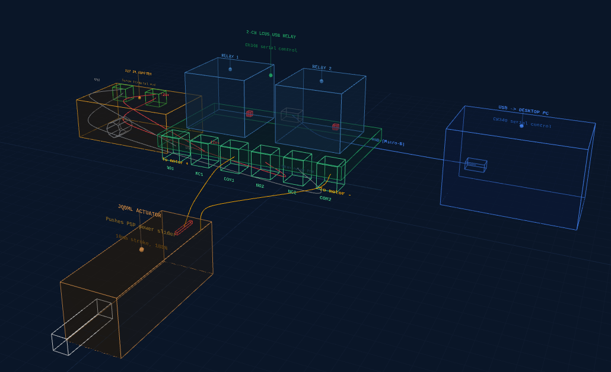](https://andrewaltimit.github.io/oasis-os/blueprint.html?diagram=psp-relay) |

PSP builds, PPSSPP testing and the devloop scripts: [Getting Started § PSP](docs/getting-started.md#psp), [PSP Architecture](docs/psp-architecture.md), [PSP Plugin](docs/psp-plugin.md).

## Architecture: write once, render anywhere

Core code never calls platform APIs. Rendering, input, networking and audio go through backend traits in `oasis-types`: implement the 13 required `SdiCore` methods and you have a working backend; the 53 methods of the nine extension traits have defaults that draw the same pixels as the native rasterizers, so overriding them is only for speed. Every backend follows one drawing-state contract, pinned by conformance tests ([design §5](docs/design.md#5-backend-abstraction-layer), [ADR-003](docs/adr/003-backend-trait-design.md)).

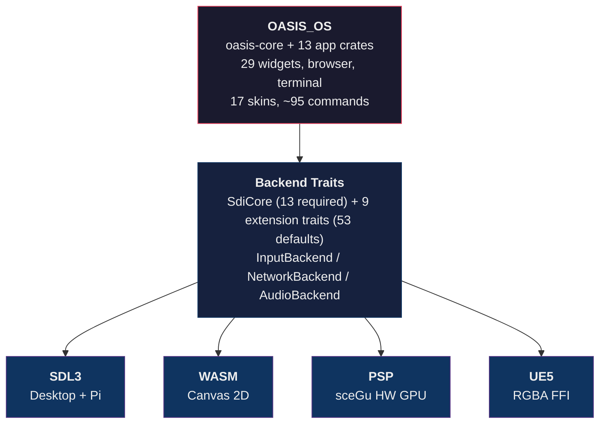

## Crates

50 crate directories under `crates/`: 40 workspace members, plus the PSP backend (explicitly excluded from the workspace) and 9 standalone PSP-target crates built individually with `cargo psp`. The dependency graph is in [CLAUDE.md](CLAUDE.md#crate-dependency-graph).

| Layer | Crates | Description |
|-------|--------|-------------|
| **Foundation** | `oasis-types`, `oasis-vfs`, `oasis-platform`, `oasis-i18n` | Backend traits, input/geometry types, span rasterizer, VFS IPC paths; virtual file system; platform service traits; internationalization |
| **Rendering** | `oasis-sdi`, `oasis-ui`, `oasis-wm`, `oasis-skin`, `oasis-vector`, `oasis-shader`, `oasis-rasterize` | Scene graph, widgets, window manager, skin engine, vector graphics, shader wallpapers, software rasterizer and glyph masks |
| **Content** | `oasis-browser`, `oasis-js`, `oasis-terminal`, `oasis-video`, `oasis-audio` | HTML/CSS/Gemini engine, QuickJS-NG, command interpreter, MP4/H.264+AAC decode, music state machine + internet radio |
| **Infrastructure** | `oasis-net`, `oasis-mcp`, `oasis-core` | TCP/PSK/TLS networking + remote terminal, optional MCP control server, coordination layer (dashboard, app runner, plugins, scripting, file transfer) |
| **Apps** | `oasis-app-core` + 13 `oasis-app-*` crates | `App` trait and helpers; games, paint, text editor, calculator, media (music + photos), TV guide, radio, settings, file manager, browser, network, package manager, system monitor |
| **Backends** | `oasis-backend-sdl`, `oasis-backend-wasm`, `oasis-backend-ue5`, `oasis-ffi` | SDL3 desktop/Pi, Canvas 2D, UE5 software framebuffer, C-ABI shared library |
| **Binaries and tools** | `oasis-app`, `oasis-usb-host`, `oasis-test-backend` | Desktop shell library + binaries (`oasis-app`, `oasis-screenshot`, `screenshot-tests`, `e2e-tests`), PSP USB thin-client host, mock/recording/conformance backends |

| PSP-only crate (built with `cargo psp`) | Description |
|-------|-------------|
| `oasis-backend-psp` | The shell EBOOT: sceGu rendering, controller input, ME video decode (in the workspace `exclude` list) |
| `oasis-plugin-psp` | Kernel-mode overlay PRX: in-game UI + background MP3 |
| `oasis-recovery-psp` | Network recovery EBOOT (WiFi TCP file server for unbricking) |
| `oasis-devloop-psp` | Remote dev-automation PRX (WiFi TCP command server) |
| `oasis-me-boot` | Minimal kernel PRX that boots the Media Engine (clean-room replacement for cooleyesBridge) |
| `oasis-prx-decrypt-psp` | Kirk-based flash0 PRX decryptor |
| `oasis-usb-client-psp`, `oasis-usb-debug-psp`, `oasis-usb-trace-psp`, `oasis-usb-vbus-psp` | USB thin-client driver and USB host-mode / VBUS research |

## Documentation

The full index is [docs/README.md](docs/README.md). Start with:

- [Getting Started](docs/getting-started.md) -- per-target setup, feature flags, environment variables, tests
- [Technical Design](docs/design.md) -- architecture, backend contract, platforms, security overview
- [Writing Apps](docs/writing-apps.md) and [Testing](docs/testing.md) -- the `App` trait and the headless shell harness
- [Skin Authoring](docs/skin-authoring.md), [Adding Commands](docs/adding-commands.md), [Plugin Development](docs/plugin-development.md)
- [ADRs](docs/adr/README.md), [Security](docs/security.md), [Troubleshooting](docs/troubleshooting.md), [Examples](examples/README.md)
- [CHANGELOG](CHANGELOG.md), [CONTRIBUTING](CONTRIBUTING.md) (AI-authored contributions only), [AGENTS.md](AGENTS.md) (agent workflow and CI)

CI runs entirely in Docker on self-hosted runners: format, clippy, docs, markdown links, tests, release build, screenshot regression, cargo-deny, benchmarks, coverage, PSP builds and a PPSSPP smoke test, then the WASM deploy to GitHub Pages.

## Security notice

> **OpenAI/Google integrations are disabled within PR reviews.** OpenAI/Google permits government partners unrestricted use of their models. We only allow models with explicit prohibitions on mass surveillance and autonomous weapons.

## License

Dual-licensed under [MIT](LICENSE-MIT) and [Unlicense](LICENSE).
