# OASIS_OS Screenshots

Every skin is captured at its native virtual resolution (from `screen_width` /
`screen_height` in `skins/<skin>/skin.toml`) by the `oasis-screenshot` binary.
Each skin gets four images: the dashboard (or desktop), the AUDIO media tab, the
MODS tab and the terminal. Only skins with a top tab bar (PSIX HiFi, Corrupted)
show a distinct MODS view; in the others `03_mods_tab.png` is the dashboard again.

## All skins

| Skin | Resolution | Dashboard | Media tab | Mods tab | Terminal |
|:---|:---:|:---:|:---:|:---:|:---:|
| PSIX HiFi | 480x272 | [01](screenshots/psix-hifi/01_dashboard.png) | [02](screenshots/psix-hifi/02_media_tab.png) | [03](screenshots/psix-hifi/03_mods_tab.png) | [04](screenshots/psix-hifi/04_terminal.png) |
| PSIX Tribute | 480x272 | [01](screenshots/psix-tribute/01_dashboard.png) | [02](screenshots/psix-tribute/02_media_tab.png) | [03](screenshots/psix-tribute/03_mods_tab.png) | [04](screenshots/psix-tribute/04_terminal.png) |
| Classic | 480x272 | [01](screenshots/classic/01_dashboard.png) | [02](screenshots/classic/02_media_tab.png) | [03](screenshots/classic/03_mods_tab.png) | [04](screenshots/classic/04_terminal.png) |
| Altimit | 480x272 | [01](screenshots/altimit/01_dashboard.png) | [02](screenshots/altimit/02_media_tab.png) | [03](screenshots/altimit/03_mods_tab.png) | [04](screenshots/altimit/04_terminal.png) |
| Modern | 480x272 | [01](screenshots/modern/01_dashboard.png) | [02](screenshots/modern/02_media_tab.png) | [03](screenshots/modern/03_mods_tab.png) | [04](screenshots/modern/04_terminal.png) |
| Vaporwave | 480x272 | [01](screenshots/vaporwave/01_dashboard.png) | [02](screenshots/vaporwave/02_media_tab.png) | [03](screenshots/vaporwave/03_mods_tab.png) | [04](screenshots/vaporwave/04_terminal.png) |
| Paper | 480x272 | [01](screenshots/paper/01_dashboard.png) | [02](screenshots/paper/02_media_tab.png) | [03](screenshots/paper/03_mods_tab.png) | [04](screenshots/paper/04_terminal.png) |
| Retro CGA | 480x272 | [01](screenshots/retro-cga/01_dashboard.png) | [02](screenshots/retro-cga/02_media_tab.png) | [03](screenshots/retro-cga/03_mods_tab.png) | [04](screenshots/retro-cga/04_terminal.png) |
| High Contrast | 480x272 | [01](screenshots/highcontrast/01_dashboard.png) | [02](screenshots/highcontrast/02_media_tab.png) | [03](screenshots/highcontrast/03_mods_tab.png) | [04](screenshots/highcontrast/04_terminal.png) |
| Corrupted | 480x272 | [01](screenshots/corrupted/01_dashboard.png) | [02](screenshots/corrupted/02_media_tab.png) | [03](screenshots/corrupted/03_mods_tab.png) | [04](screenshots/corrupted/04_terminal.png) |
| Win95 | 640x480 | [01](screenshots/win95/01_dashboard.png) | [02](screenshots/win95/02_media_tab.png) | [03](screenshots/win95/03_mods_tab.png) | [04](screenshots/win95/04_terminal.png) |
| Desktop | 800x600 | [01](screenshots/desktop/01_dashboard.png) | [02](screenshots/desktop/02_media_tab.png) | [03](screenshots/desktop/03_mods_tab.png) | [04](screenshots/desktop/04_terminal.png) |
| macOS | 800x600 | [01](screenshots/macos/01_dashboard.png) | [02](screenshots/macos/02_media_tab.png) | [03](screenshots/macos/03_mods_tab.png) | [04](screenshots/macos/04_terminal.png) |
| GNOME | 800x600 | [01](screenshots/gnome/01_dashboard.png) | [02](screenshots/gnome/02_media_tab.png) | [03](screenshots/gnome/03_mods_tab.png) | [04](screenshots/gnome/04_terminal.png) |
| Balatro | 800x600 | [01](screenshots/balatro/01_dashboard.png) | [02](screenshots/balatro/02_media_tab.png) | [03](screenshots/balatro/03_mods_tab.png) | [04](screenshots/balatro/04_terminal.png) |
| Solarized | 800x600 | [01](screenshots/solarized/01_dashboard.png) | [02](screenshots/solarized/02_media_tab.png) | [03](screenshots/solarized/03_mods_tab.png) | [04](screenshots/solarized/04_terminal.png) |
| XP | 1024x768 | [01](screenshots/xp/01_dashboard.png) | [02](screenshots/xp/02_media_tab.png) | [03](screenshots/xp/03_mods_tab.png) | [04](screenshots/xp/04_terminal.png) |

## Dashboards

480x272 (PSP native):

| PSIX HiFi | PSIX Tribute | Classic | Altimit | Modern |
|:---:|:---:|:---:|:---:|:---:|
| 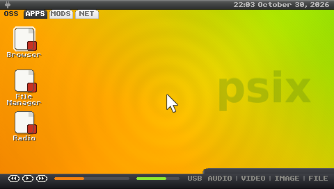 | 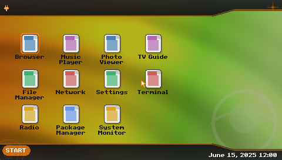 | 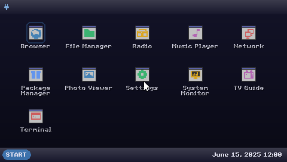 |  | 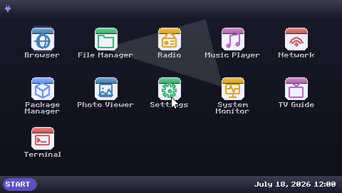 |

| Vaporwave | Paper | Retro CGA | High Contrast | Corrupted |
|:---:|:---:|:---:|:---:|:---:|
|  |  |  | 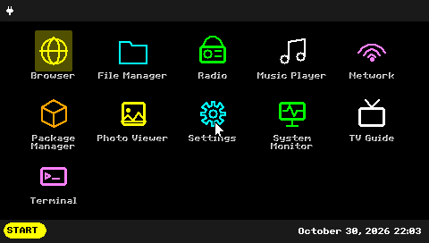 | 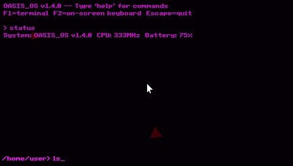 |

640x480, 800x600 and 1024x768:

| Win95 (640x480) | Desktop (800x600) | macOS (800x600) |
|:---:|:---:|:---:|
|  | 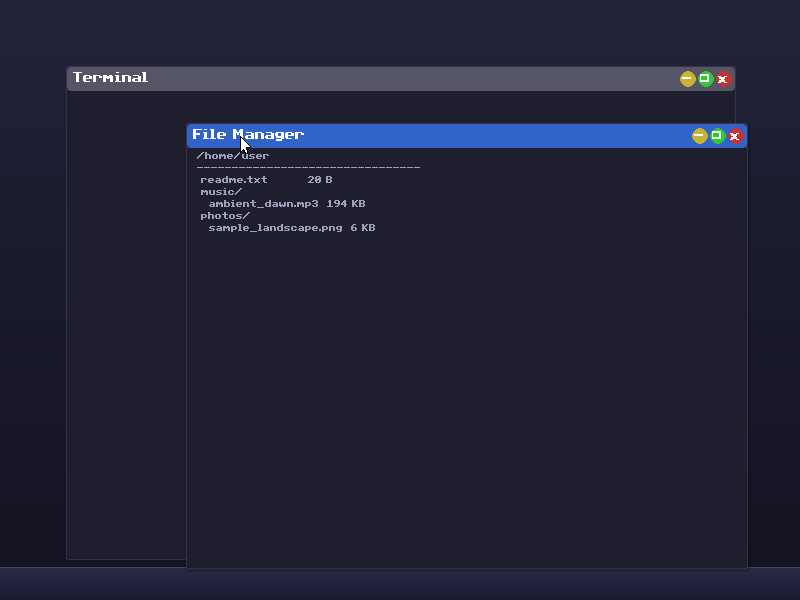 |  |

| GNOME (800x600) | Balatro (800x600) | Solarized (800x600) | XP (1024x768) |
|:---:|:---:|:---:|:---:|
|  |  |  |  |

## Terminals

| PSIX HiFi | PSIX Tribute | Classic | Altimit | Modern |
|:---:|:---:|:---:|:---:|:---:|
| 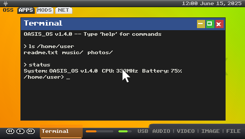 | 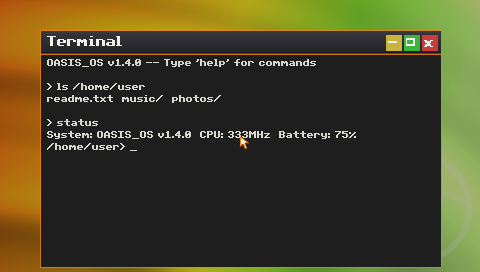 | 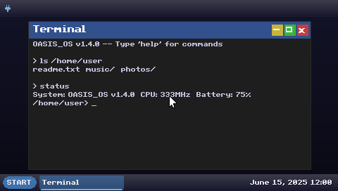 | 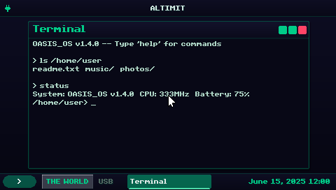 | 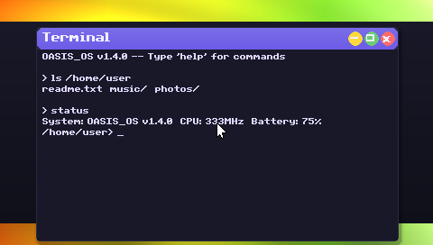 |

| Vaporwave | Paper | Retro CGA | High Contrast | Corrupted |
|:---:|:---:|:---:|:---:|:---:|
| 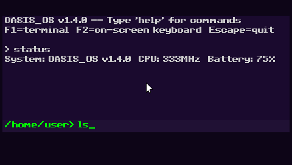 | 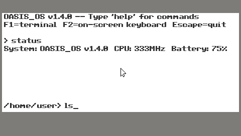 | 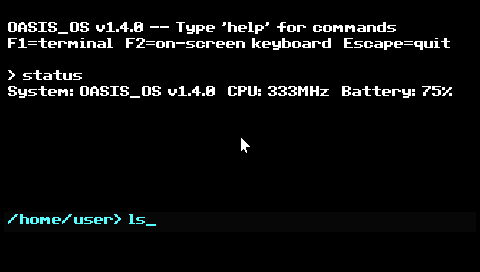 | 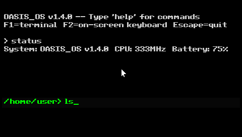 | 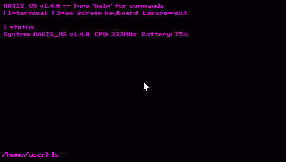 |

| Win95 | Desktop | macOS |
|:---:|:---:|:---:|
| 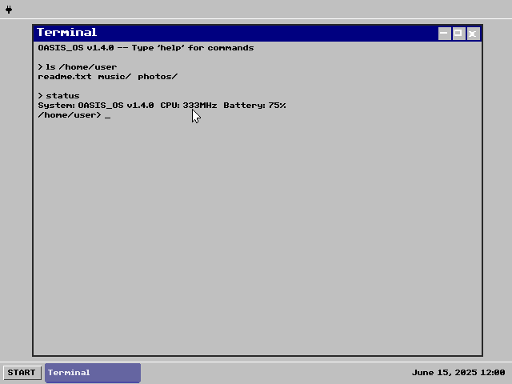 | 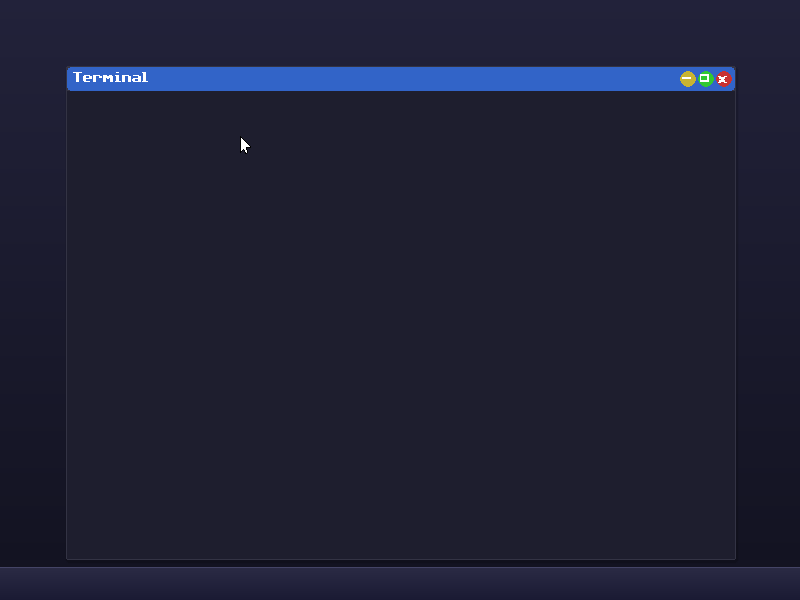 | 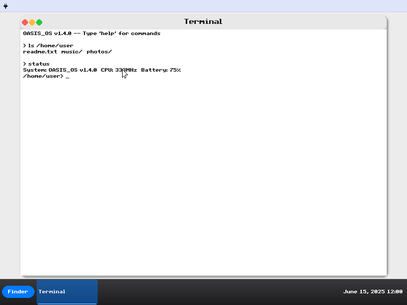 |

| GNOME | Balatro | Solarized | XP |
|:---:|:---:|:---:|:---:|
| 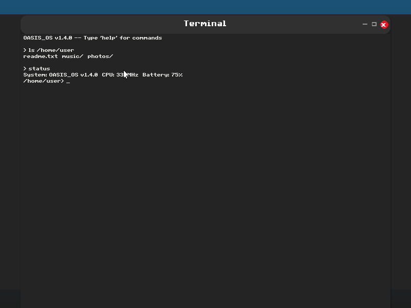 | 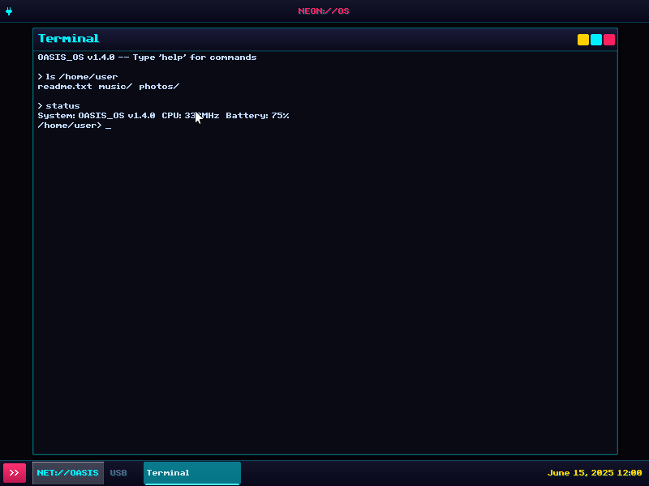 | 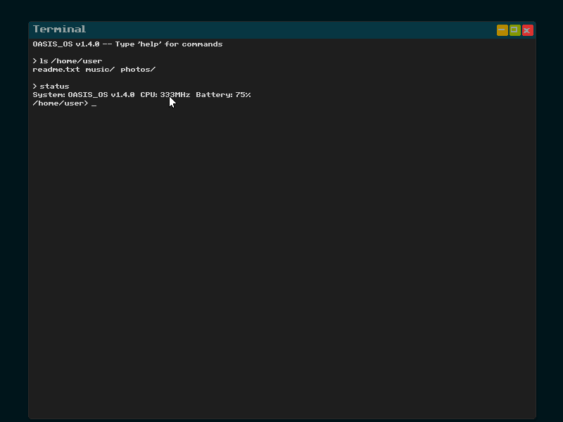 | 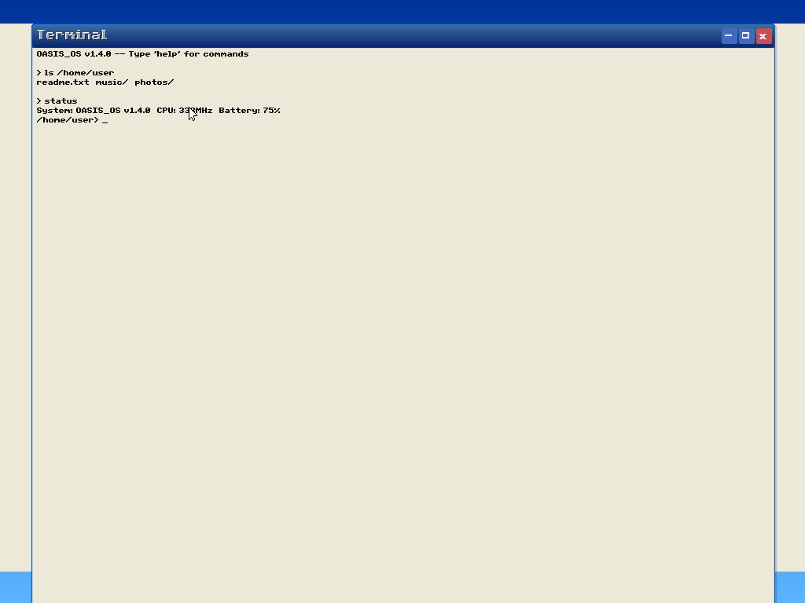 |

## Media and Mods tabs

| Classic media | Classic mods | PSIX HiFi media | PSIX HiFi mods |
|:---:|:---:|:---:|:---:|
| 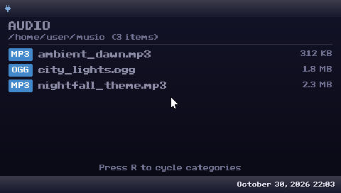 |  | 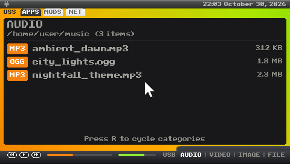 | 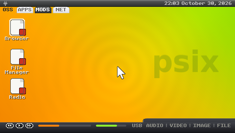 |

The other skins' tab views are linked from the [table above](#all-skins).

## Generating Screenshots

The images are static captures: shader wallpapers render a single frame, and the
corrupted skin's runtime glitch effect is not applied. Pin the clock, the shader
frame and SDL's software renderer so a re-capture only changes what the code
changed (the committed set shows `2026-10-30 22:03`):

```bash
SDL_VIDEODRIVER=dummy SDL_RENDER_DRIVER=software \
OASIS_FIXED_TIME="2026-10-30 22:03:00" OASIS_FIXED_FRAME=0 \
  cargo run -p oasis-app --bin oasis-screenshot -- --all      # all 17 skins

# ...or one skin
cargo run -p oasis-app --bin oasis-screenshot -- psix-hifi
```

Without system ffmpeg dev libraries (e.g. on Windows), add
`--no-default-features --features javascript,video-decode`.

These committed images are documentation, not a CI baseline. CI's screenshot
regression step runs the separate `screenshot-tests` binary into the gitignored
`screenshots/tests/` and compares it against `screenshots/baseline/` only when that
directory exists.
